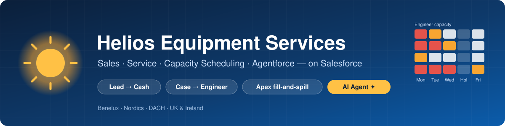
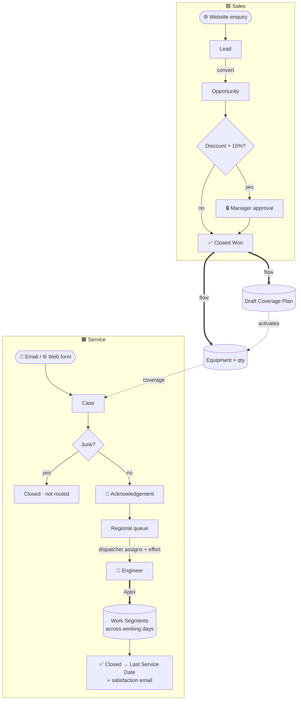
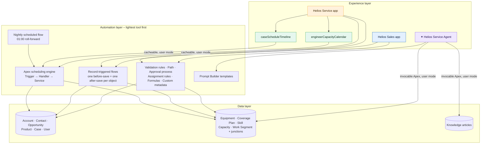
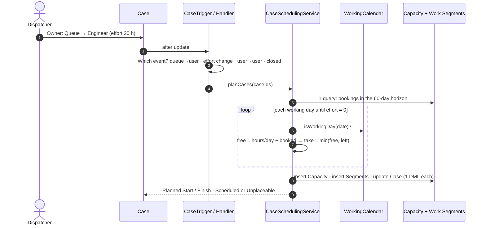
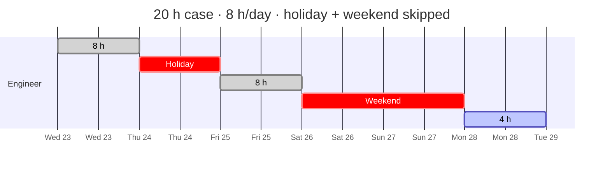
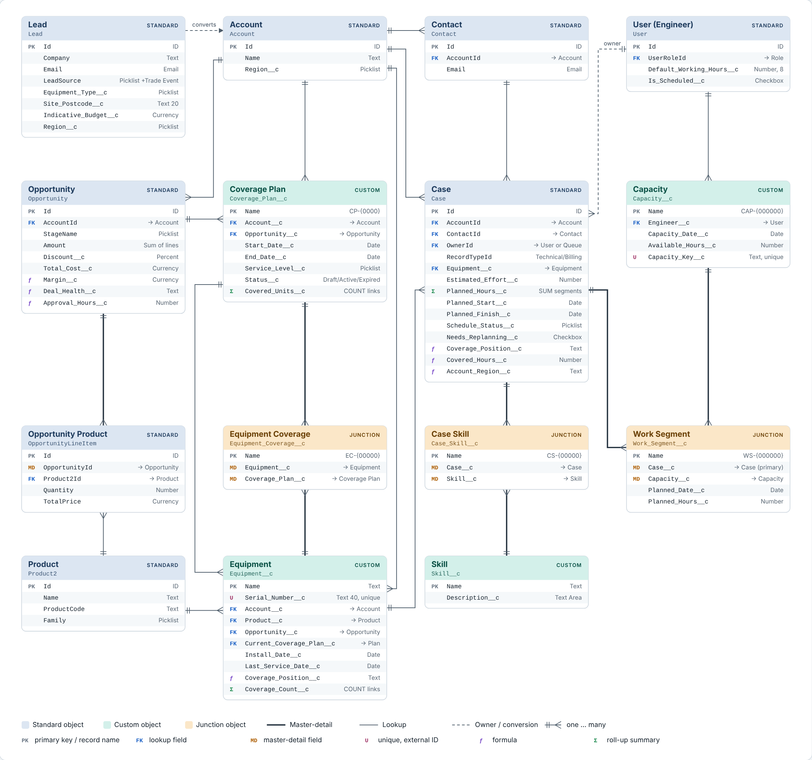
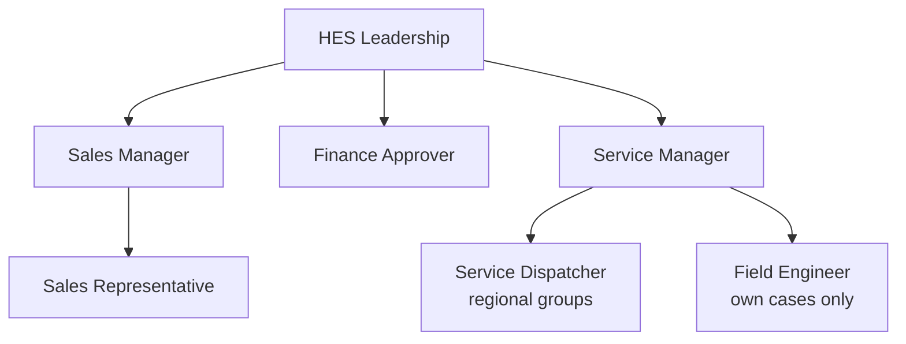

<p align="center">
  
</p>

<p align="center">
  
  
  
  
  
  
  
</p>

<p align="center">
  <b>A complete Salesforce solution for an industrial equipment company:<br>
  disciplined selling, zero-retype service intake, automatic engineer scheduling, leadership dashboards and an AI assistant.</b>
</p>

<p align="center">
   <a href="https://helioservice.netlify.app/">Helios WebSite</a>
  <a href="#-the-business">Business</a> •
  <a href="#-the-solution-at-a-glance">Solution</a> •
  <a href="#-how-it-works">How it works</a> •
  <a href="#-scheduling-engine">Scheduling engine</a> •
  <a href="#-data-model">Data model</a> •
  <a href="#-security">Security</a> •
  <a href="#-ai--agentforce">AI</a> •
  <a href="#-getting-started">Getting started</a> •
  <a href="#-documentation">Docs</a>
</p>

---

## 🏭 The business

**Helios Equipment Services (HES)** sells, installs and services industrial **chillers, compressors and air dryers** across four regions: **Benelux, Nordics, DACH and UK & Ireland**.

Before this project, HES had four problems:

|     | Pain point                                                                  | Impact                                                                                         |
| --- | --------------------------------------------------------------------------- | ---------------------------------------------------------------------------------------------- |
| 💸  | Discounts above 15 % were given without control                             | Margin leaked and nobody could see who approved what                                           |
| 📨  | Service requests arrived by email and web form and were **retyped** by hand | Slow, error-prone, nothing was acknowledged                                                    |
| 📅  | Engineer time was planned **in a spreadsheet**                              | Usually wrong; engineers double-booked or idle. **This is the main reason the project exists** |
| 📊  | Leadership exported data to Excel to see anything                           | No single view of pipeline or service workload                                                 |

## ✨ The solution at a glance

<table>
<tr>
<td width="33%" valign="top">

### 🟦 Helios Sales app

- Web enquiry → Lead → Opportunity
- Stage discipline with **Path** and a non-bypassable rule
- **Deal Health** (At Risk / Healthy)
- **Discount approval > 15 %** with record lock and audit trail
- **Closed Won** auto-creates equipment and a draft coverage plan

</td>
<td width="33%" valign="top">

### 🟧 Helios Service app

- **Email-to-Case** and **Web-to-Case** with no retyping
- Junk filter, auto-acknowledgement, **regional routing**
- Technical and Billing cases
- Live **coverage position** (Covered / Expired / Not Covered)
- **Automatic capacity scheduling** of engineer time
- Capacity calendar and case timeline (LWC)

</td>
<td width="33%" valign="top">

### 🟪 Helios Service Agent

- Agentforce **employee agent**
- Answers from **knowledge articles**
- Checks **equipment coverage** by serial number
- **Creates cases** from a conversation (with confirmation)
- AI **case summary**, **reply draft**, **account briefing**

</td>
</tr>
</table>

> **3 apps · 2 business domains · 1 AI agent.** Every user-facing message comes from a custom label, every email goes through an Email Alert, and every custom item carries a description.

---

## 🔄 How it works

### End-to-end business flow



### Solution architecture



---

## ⚙️ Scheduling engine

The heart of the project. When a dispatcher assigns a case to an engineer, Apex **fills the engineer's free hours day by day and spills the rest onto the next working day**. It skips weekends and holidays and never double-books.



**Example (Appendix A3).** A 20 h case is assigned on Wednesday 23 Dec 2026. The engineer works 8 h a day and 24 Dec is a holiday:



| Event                 | What the engine does                                                          |
| --------------------- | ----------------------------------------------------------------------------- |
| Queue → engineer      | Plans the full effort from today                                              |
| Effort changed        | Removes future segments and replans the outstanding hours                     |
| Engineer → engineer   | **Keeps today and earlier as history** and moves the rest to the new engineer |
| Case closed           | Removes future segments only                                                  |
| Nightly at 01:00      | Rolls stale segments of open cases forward and flags _Needs Replanning_       |
| Effort beyond 60 days | Keeps what fits and marks **Unplaceable**                                     |

**Bulk-safe by design:** there is no SOQL or DML inside any loop. Measured in the org, reassigning **1 or 50 cases costs the same: 8 SOQL, 3 DML, ~259 ms CPU**. A test plans **200 cases for 20 engineers in a single transaction**.

---

## 🗂 Data model

<p align="center">
  
</p>

| Object                 | Why it exists                                     | Key relationship decision                                                             |
| ---------------------- | ------------------------------------------------- | ------------------------------------------------------------------------------------- |
| **Equipment**          | One installed unit (serial number)                | _Lookup_ to Account, so deleting a customer never wipes installed-base history        |
| **Coverage Plan**      | Service agreement with period and level           | Custom object, not the standard ServiceContract, which needs Entitlements             |
| **Equipment Coverage** | A unit can be covered by many plans over its life | _Master-detail_ on both sides, giving roll-ups both ways                              |
| **Skill / Case Skill** | Skills a case requires                            | Junction with a unique key, so duplicates are impossible even in bulk                 |
| **Capacity**           | One engineer-day                                  | _Lookup_ to User (User can't be a master) with a unique engineer+date key for upserts |
| **Work Segment**       | One planned block of a case on one date           | _Master-detail_ to Case (rolls up Planned Hours) and to Capacity                      |

> 💡 **Coverage is derived, never stored.** A formula reads the current plan, so a plan that expires overnight is shown correctly the next morning without any batch job.

---

## 🔐 Security



- **Least privilege:** each persona uses the _Minimum Access_ profile plus **one permission set**. No Delete or Modify All anywhere.
- **Private by default:** Lead, Account, Opportunity and Case are Private. Engineers see only their own cases.
- **Regional dispatchers:** criteria sharing rules give each region's group only its own open cases.
- **Margin protection:** Total Cost, Margin and Margin % are hidden from sales reps by field-level security.
- **Controlled bypass:** a custom permission lets data loads skip validation, except the Negotiation rule, which is never bypassed.

---

## ✦ AI & Agentforce

| Feature              | Built with                                 | What the user gets                                                 |
| -------------------- | ------------------------------------------ | ------------------------------------------------------------------ |
| Case summary         | Prompt Builder · Field Generation          | A three-sentence summary of the case and its comments in one click |
| Customer reply draft | Prompt Builder · Flex + screen flow        | An editable reply that uses the case plan and coverage             |
| Account briefing     | Prompt Builder · Record Summary            | A pre-visit brief of the account                                   |
| Knowledge answers    | Agent + `SearchServiceArticlesAction`      | Maintenance answers from published articles                        |
| Coverage check       | Agent + `CoverageLookupAction`             | "Is SN-4402 covered?" answered instantly                           |
| Case from chat       | Agent + `CreateCaseFromConversationAction` | A routed case after the user confirms                              |

🛡 The agent **runs as the signed-in user**, and every action is `with sharing` and queries in **user mode**. An engineer asking about margins gets nothing, because field security blocks it as well as the instructions.

---

## 📊 Analytics

| Dashboard              | Highlights                                                                                          | Runs as                                         |
| ---------------------- | --------------------------------------------------------------------------------------------------- | ----------------------------------------------- |
| **Service Operations** | Open cases by queue · planned hours by engineer · covered work % · effort bands · unplaceable cases | A fixed user, so dispatchers see every region   |
| **Sales Performance**  | Pipeline by stage and owner · discount distribution · approval time · deal health                   | The viewer, so reps see only their own pipeline |

All reports use **relative date filters**, so nobody ever edits a date.

---

## 🧪 Quality

| Area                                                     | Result                                                                                               |
| -------------------------------------------------------- | ---------------------------------------------------------------------------------------------------- |
| Scheduling engine (Appendix A1–A7, bulk, negative paths) | ✅ 14 / 14 tests · 100 % coverage                                                                    |
| All Apex after module 8                                  | ✅ 19 / 19 tests · 100 % org-wide coverage                                                           |
| Agent Apex actions                                       | ✅ Tested, including users with no access                                                            |
| LWC (Jest)                                               | ✅ Capacity calendar 6 tests · timeline 4 tests                                                      |
| Manual org tests                                         | ✅ A1–A7, reassignment, closure and effort change on real cases                                      |
| Sample data                                              | ✅ 25 accounts · 60 contacts · 120 equipment · 30 plans · 40 opportunities · 250 cases · 10 articles |

---

## 🚀 Getting started

**Prerequisites:** Salesforce CLI (`sf`), Node.js, a Developer Edition org with Einstein generative AI, Prompt Builder, Data Cloud and Agentforce enabled.

```bash
# 1. Clone and install
git clone <this-repo-url>
cd <repo-folder>
npm install

# 2. Authorise your org
sf org login web --alias hes --set-default

# 3. Deploy the metadata
sf project deploy start --source-dir force-app

# 4. Run the Apex tests
sf apex run test --test-level RunLocalTests --code-coverage --result-format human --wait 15

# 5. Load the sample data (see docs/setup-steps.md for the temporary settings first)
sf apex run --file scripts/apex/seed-1-accounts-contacts.apex
sf apex run --file scripts/apex/seed-2-products-equipment-plans.apex
sf apex run --file scripts/apex/seed-3-opportunities.apex
sf apex run --file scripts/apex/seed-3b-negotiation.apex
sf apex run --file scripts/apex/seed-4-cases.apex
sf apex run --file scripts/apex/seed-counts.apex
```

> ⚠️ Some setup can't be deployed as metadata: Email-to-Case, org-wide email addresses, business hours and holidays, and Agentforce activation. These manual steps are listed in [`docs/setup-steps.md`](docs/setup-steps.md).

<details>
<summary><b>📁 Repository structure</b></summary>

```text
force-app/main/default/
├── classes/          Apex: scheduling engine, LWC controllers, agent actions, tests
├── triggers/         CaseTrigger (thin)
├── lwc/              Capacity calendar, schedule timeline (+ Jest tests)
├── flows/            Record-triggered, screen and scheduled flows
├── objects/          Custom objects, fields, validation rules, record types
├── permissionsets/   One set per persona + agent and data-loader sets
├── genAiPromptTemplates/  Case summary, reply draft, account briefing
├── applications/     Helios Sales, Helios Service
└── ...               Reports, dashboards, labels, custom metadata, email templates
scripts/apex/         Seed data and test helper scripts
docs/                 Design, security, data model, test evidence, solution document
```

</details>

<details>
<summary><b>👥 Personas</b></summary>

| Persona              | App                    | Main job                                           |
| -------------------- | ---------------------- | -------------------------------------------------- |
| Sales Representative | Helios Sales           | Works leads and opportunities                      |
| Sales Manager        | Helios Sales           | Approves discounts, sees team pipeline             |
| Finance Approver     | Helios Sales           | Read-only pipeline, margin visibility              |
| Service Dispatcher   | Helios Service         | Triages, sets effort and skills, assigns engineers |
| Field Engineer       | Helios Service + Agent | Works own cases, asks the agent                    |
| Service Manager      | Helios Service         | Sees all service work and dashboards               |

The developer org's licence limit means three users play these personas by swapping permission sets ([`docs/persona-mapping.md`](docs/persona-mapping.md)).
</details>

---

## 📚 Documentation

| Document                                                                                 | Contents                                                                        |
| ---------------------------------------------------------------------------------------- | ------------------------------------------------------------------------------- |
| [Solution document (PDF)](docs/solution-document.pdf)                                    | Six-page design overview: data model, tool choice, algorithm, agent permissions |
| [Data model](docs/data-model.md)                                                         | Every object, field and relationship decision                                   |
| [Design](docs/design.md)                                                                 | Functional design and decisions log per requirement                             |
| [Scheduling design](docs/scheduling-design.md) · [examples](docs/scheduling-examples.md) | Engine design and hand-calculated A1–A7 results                                 |
| [Security model](docs/security-model.md)                                                 | Permission sets, OWD, roles and sharing                                         |
| [Agent permissions](docs/agent-permissions.md)                                           | Why the agent can see what it sees                                              |
| [Automation inventory](docs/automation-inventory.md)                                     | Every flow, rule, alert and label                                               |
| [Test evidence](docs/test-evidence.md)                                                   | Test log with results and screenshots                                           |

---

## 🧭 Engineering conventions

`[WBS:x-xx] type(scope): message` commits · one branch per requirement · feature → `development` → `main` · no hardcoded IDs · labels for every message · Email Alerts for every email · descriptions on everything · bulk-safe Apex with user-mode queries.

<p align="center">
  <sub>Built by <b>Ajmayen Fayek</b> · Salesforce implementation of the Helios Equipment Services project brief</sub>
</p>
